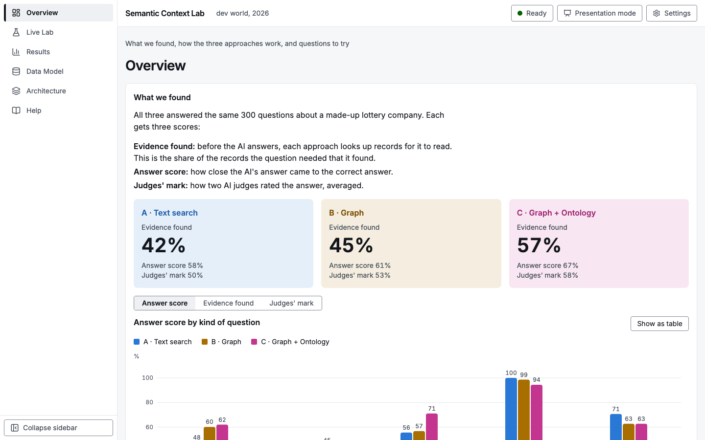
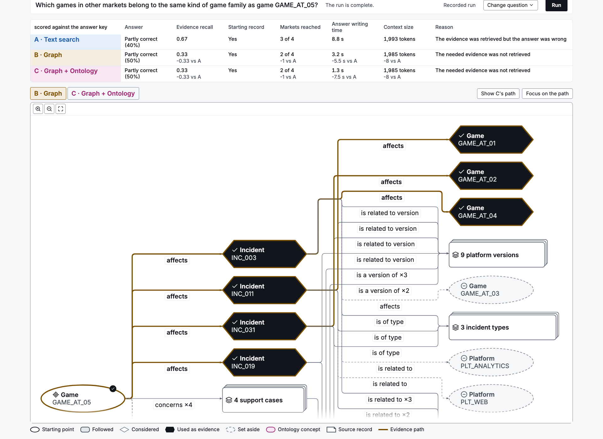
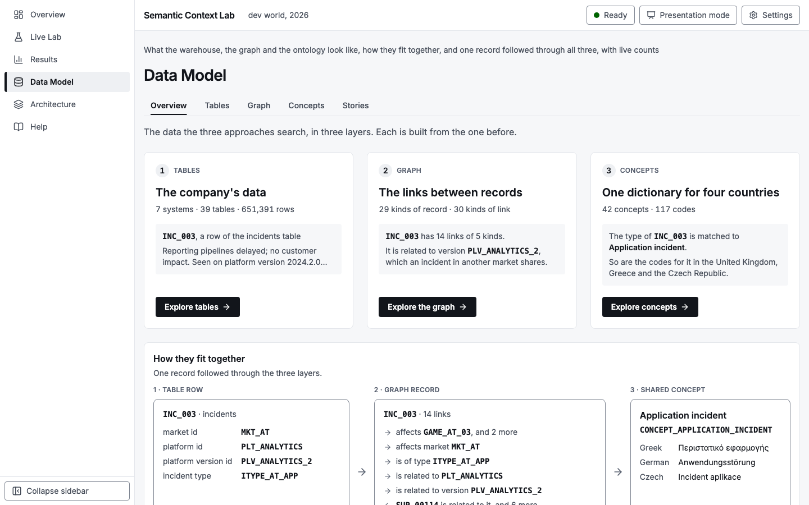
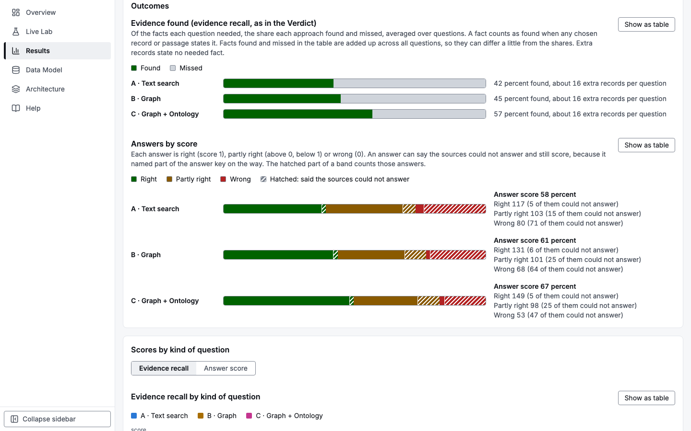
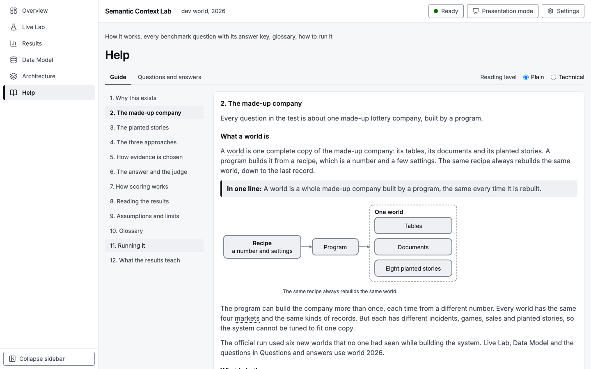

# Semantic Context Lab


An experiment that measures what a knowledge graph and an enterprise ontology add on top of an existing enterprise data layer.
It runs in a made-up multinational lottery company in the United Kingdom, Greece, Austria and the Czech Republic, and every record, document and name in it is synthetic.



The one tested result: on questions that need several linked records, the graph (B) found 22.1 percentage points more of the needed evidence than text search (A) (95 percent interval 10.4 to 34.1, Holm-adjusted p 0.030); the other 13 of 14 pre-registered comparisons, including every test of the ontology (C against B), showed no detectable difference.
The full numbers and their limits are in [docs/results-summary.md](docs/results-summary.md).

## How it works

- Three approaches answer each question: A is text search over the documents (conventional RAG), B adds the graph of links between records, and C adds the enterprise ontology on top of B.
- All three get the same questions, the same synthetic world, the same embedding model and the same answer model, with one shared evidence budget.
- The answer key is planted by the program that builds the world, and no approach can see it.
- Answers are scored by fixed rules, with two AI judges as a second opinion.

The graph does not replace the data layer.
It makes relationships and enterprise meaning available to AI.
The experiment is not a comparison of databases.
Fairness rules and the shared context budget are in [docs/retrieval.md](docs/retrieval.md).

## The screens

| | |
|---|---|
|  |  |
| **Live Lab**: one question through A, B and C, with the graph drawn from the real retrieval events. | **Data Model**: the warehouse, the graph and the ontology, with live counts. |
|  |  |
| **Results**: the official run, with scores, intervals and outcomes by approach. | **Help**: how it works in plain language, with a technical reading level too. |

## Run it

Requirements are Python 3.13 with `uv`, Node 24 with `pnpm`, Docker for Neo4j and Qdrant, and Ollama for the embedding model and local answer models.
Settings go in a root `.env` (copy `.env.example`), which `make` reads.

```bash
make setup               # Python, frontend and Playwright dependencies
make services-up         # Neo4j and Qdrant
make pull-models         # the embedding model, with Ollama running
make generate-dev-data   # the synthetic world
make ingest-graph        # the graph, in Neo4j
make index-vector        # the document index, in Qdrant
make ground-bank         # freeze the question bank into this world
make dev                 # API on :8000 and the screens on :5173
make dev-official        # the same, answering with the official run's model (qwen3.6), for a demo
```

Open `http://localhost:5173`.
A fresh clone has no `data/` directory, so generate the world first.
The demonstration targets, recovery steps and every setting are in [docs/operations.md](docs/operations.md).
To host a read-only copy with recorded runs and results only, see "Deploying the public site" in [docs/operations.md](docs/operations.md) (`PUBLIC_MODE`).

The product has six screens, and each is a link:

| Screen | Link | What it is for |
|---|---|---|
| Overview | `http://localhost:5173/#/overview` | The verdict from the latest official run, how the approaches differ, and a way into Live Lab |
| Live Lab | `http://localhost:5173/#/live-lab` | Run one question through A, B and C and watch them work |
| Results | `http://localhost:5173/#/results` | Published benchmark runs with their scores, questions and reproducibility record, and a form to start a run |
| Data Model | `http://localhost:5173/#/data-model` | The warehouse, graph, ontology and scenarios, with live counts |
| Architecture | `http://localhost:5173/#/architecture` | The tech stack as one diagram: the data platform, the graph and ontology layers on top, and what each part runs on |
| Help | `http://localhost:5173/#/help` | How it works, every benchmark question with its answer key, the glossary and how to run it |

Live Lab can replay a recorded run, which needs no model, or run a question live, which needs the services, the vector index, the graph and the answer model.
Add `?present=1` to the address, or use the header button, for presentation mode.

Tests, without services or a model:

```bash
make test
```

## Map of the documents

Ten primary documents hold the current truth, and one page holds the full headline numbers.

| Document | Holds |
|---|---|
| [README.md](README.md) | What the lab does at a glance, how to run it |
| [docs/results-summary.md](docs/results-summary.md) | The headline numbers of the official run, in full |
| [docs/architecture.md](docs/architecture.md) | System, backend, frontend, model gateway, events, persistence, security, decision index |
| [docs/data.md](docs/data.md) | The synthetic world, the warehouse, documents and provenance |
| [docs/graph-and-ontology.md](docs/graph-and-ontology.md) | The graph model, ingestion, the ontology and cross-market mappings |
| [docs/scenarios.md](docs/scenarios.md) | The eight planted scenarios and the truth ledger |
| [docs/retrieval.md](docs/retrieval.md) | Pipelines A, B and C, the fairness contract, the context budget and re-ranking |
| [docs/evaluation.md](docs/evaluation.md) | The question bank, scoring, the judge, statistics and reproducibility |
| [docs/api.md](docs/api.md) | Routes, events and errors |
| [docs/ux.md](docs/ux.md) | Screens, visual language, interaction, accessibility and presentation mode |
| [docs/operations.md](docs/operations.md) | Running, models, the demonstration, recovery, troubleshooting, testing and CI |

The generated question bank is `docs/evaluation/question-bank.md`.

Governance files stay at the repository root:

- `AGENTS.md`: the rules for working in this repository, including the human approval checkpoints
- `HITL_STATUS.md`: the status of each gate and checkpoint
- `DECISIONS.md`: the numbered decisions and who approved them
- `CHANGELOG.md`: generated release notes
- `CONTRIBUTING.md`: how to contribute
- `RELEASE.md`: the release record

`docs/superpowers/` holds the overhaul design and the implementation plans.
`docs/reference/` is an archive of the documents written before and during the build, kept unchanged, with a note on which primary document replaced each file.
